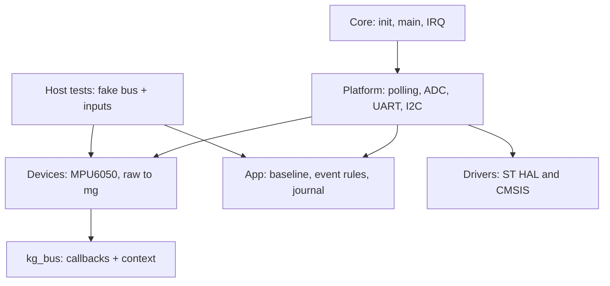
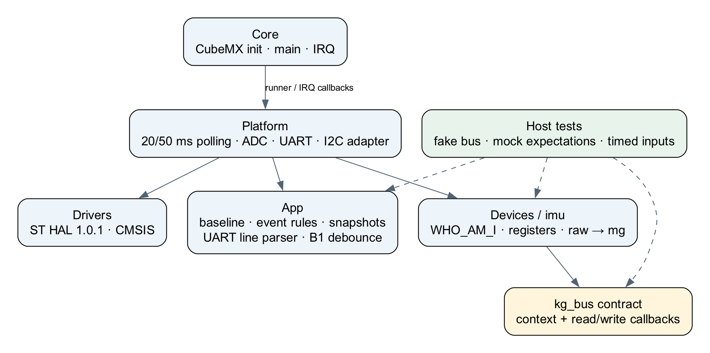

# Архітектура

Core містить ініціалізацію та IRQ STM32CubeMX. Drivers містить незмінений ST HAL
1.0.1 і CMSIS із ЛР1. Додані ADC/ADCEx/LL_ADC відповідають ST tag v1.0.1,
commit 24999b605d0b9da3e4675c4c884036ae724bb59f. Нових сторонніх C-бібліотек немає.

Platform володіє периферійними handles, пінами, таймерами опитування й UART.
Devices/imu отримує kg_bus з context та read/write callbacks. 7-бітна адреса
належить драйверу, перетворення адреси HAL належить Platform.
App/kiosk зберігає режим, baseline, фільтри та чергу подій.
Жоден переносимий файл не включає HAL, CMSIS або Platform.

Автоматична перевірка: python3 tools/check_structure.py. Host compilation додатково
збирає App і Devices без заголовків МК. Повторна генерація CubeMX не повинна
видаляти Platform, Devices, App; зв'язок main з runner розміщено в USER CODE.

Продукт використовує два незалежні виміри механіки: різницю сусідніх векторів
для удару і кут до зафіксованого baseline для переміщення. PIR не встановлює
alarm або session. Сервіс змінює severity запису, а не вимикає опитування.

Core USER CODE викликає Platform runner. B1 після Core init повторно
ініціалізується runtime як input pull-up; це відповідає ioc. IRQ EXTI
не використовується. I²C adapter належить Platform; vendor HAL не змінювали.

## Доповнення ЛР3

`App/cadence` обліковує абсолютні release, skipped slots, джиттер і completion
deadline. `Platform/runtime` викликає задачі на одному стеку з активним опитуванням.
`Platform/measure` використовує SysTick з кроком 1 мс; ця роздільність не
дозволяє достовірно оцінити CPU/WCET. `CLOCK_UNSUPPORTED` припиняє задачі,
якщо базовий час не рухається.

`App/audit` серіалізує окремі лічильники категорій термінала у checkpoint.
`Platform/nvflash` є адаптером внутрішньої flash C031. Межа між ними дозволяє
host byte-cut тести без HAL. Останні 4 КіБ вилучено з executable flash linker
region. Журнал не відновлює service як поточний режим після reset.

`Core/Src/sysmem.c` експортує peak `_sbrk` для бібліотечних виділень. Цей hook
треба зберегти після повторної генерації Core. Власний прикладний код malloc
не викликає. ISR та foreground ділять RX, timestamps і індекси; публікація RX використовує DMB.
Retry прийому обмежений і виконується в циклі.

Історична схема попереднього TIM3/WFI варіанта: [SVG](captures/kioskguard-lr3-architecture.svg),
[редагована модель](architecture-lab3.json). Вона не є схемою поточного таймера та циклу. Стан вимірювань та межі перевірки
описані в [metrics](metrics/README.md) і [limitations](limitations.md).
