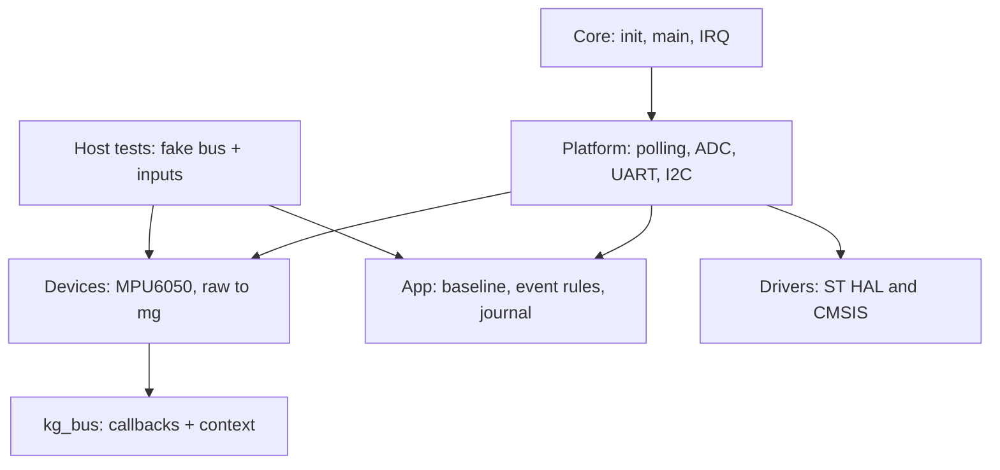

# Архітектура

Core містить ініціалізацію та IRQ STM32CubeMX. Drivers містить незмінений ST HAL
1.0.1 і CMSIS із ЛР1. Додані ADC/ADCEx/LL_ADC відповідають ST tag v1.0.1,
commit 24999b605d0b9da3e4675c4c884036ae724bb59f. Нових сторонніх C-бібліотек немає.

Platform володіє периферійними handles, пінами, таймерами опитування й UART.
Devices/imu отримує kg_bus з context та read/write callbacks. 7-бітна адреса
належить драйверу, перетворення адреси HAL належить Platform.
App/kiosk зберігає режим, baseline, фільтри та чергу подій.
Жоден переносимий файл не включає HAL, CMSIS або Platform.

Автоматична перевірка: python3 tools/check_structure.py. Host compilation додатково
збирає App і Devices без заголовків МК. Повторна генерація CubeMX не повинна
видаляти Platform, Devices, App; зв'язок main з runner розміщено в USER CODE.

Продукт використовує два незалежні виміри механіки: різницю сусідніх векторів
для удару і кут до зафіксованого baseline для переміщення. PIR не встановлює
alarm або session. Сервіс змінює severity запису, а не вимикає опитування.
